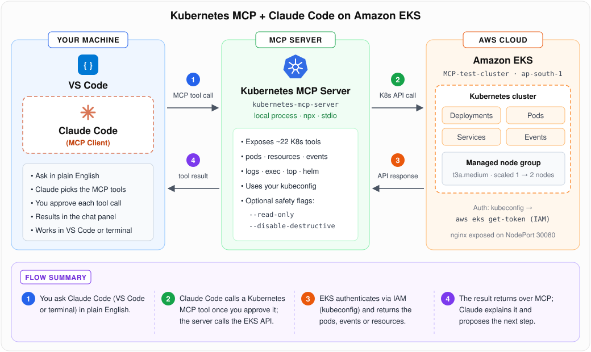

# ☸️ Kubernetes MCP + Claude Code on Amazon EKS

Manage an Amazon EKS cluster in plain English from **Claude Code** (in VS Code or the terminal), using the open-source
[Kubernetes MCP server](https://github.com/containers/kubernetes-mcp-server).

The demo is a real troubleshooting run. Claude Code deploys nginx, finds out *why* the pod is stuck in `Pending`
(`FailedScheduling: Too many pods`), confirms the fix after the node group is scaled, and returns a working NodePort endpoint.

<p>
  
  
  
  
  
  
</p>

## Architecture

<p align="center">
  
</p>

| Step | What happens |
|:---:|---|
| **1** | You ask Claude Code something like *"why is my nginx pod Pending?"*. Claude chooses a Kubernetes MCP tool (e.g. `pods_get`, `events_list`) and asks for your approval. |
| **2** | Claude Code sends the tool call over **MCP (JSON-RPC on stdio)** to `kubernetes-mcp-server`, a local process started with `npx`. |
| **3** | The MCP server calls the **EKS Kubernetes API** using your current kubeconfig context. Auth goes through IAM via `aws eks get-token`. |
| **4** | The result returns over MCP, and Claude reads it, explains the root cause and proposes the next step. |

> The MCP server runs **on your machine**, not in the cluster. It can do exactly what your kubeconfig identity can do, no more and no less. Use `--read-only` for a safe demo (see [Safety](#-safety)).

## What this project shows

- Connecting an **MCP client (Claude Code)** to an **MCP server (Kubernetes)**, both at user scope and per project (`.mcp.json`)
- Managing a cluster through **natural language**: list, deploy, expose and diagnose
- **Agent-led root-cause analysis** of a `Pending` pod from pod conditions and events
- **Guardrails**: per-tool approval, an allowlist for read-only tools, and the server's `--read-only` / `--disable-destructive` flags

## Repo contents

```text
01-kubernetes-mcp-eks/
├── README.md
├── architecture.svg              # flow diagram above
├── eks-cluster.yaml              # eksctl config (1 × t3a.medium, scales to 3)
├── .mcp.json                     # project-scoped MCP server for Claude Code (Windows)
├── .claude/settings.json         # auto-allow read-only K8s tools, always ask for writes
└── manifests/nginx-nodeport.yaml # what the agent created, for a no-agent replay
```

## Prerequisites

| Tool | Why | Install (Windows, PowerShell) |
|---|---|---|
| AWS account + IAM user/role | Create and access EKS | `aws configure` |
| AWS CLI v2 | kubeconfig + IAM auth | `winget install -e --id Amazon.AWSCLI` |
| eksctl | Create the cluster | `winget install -e --id eksctl.eksctl` |
| kubectl | Verify the cluster yourself | `winget install -e --id Kubernetes.kubectl` |
| Node.js LTS (`npx`) | Runs the MCP server | `winget install -e --id OpenJS.NodeJS.LTS` |
| Claude Code | MCP client | `irm https://claude.ai/install.ps1 \| iex` + the **Claude Code** VS Code extension |

```powershell
aws --version; eksctl version; kubectl version --client; node -v; npx -v; claude --version
```

> 💰 **Cost:** EKS control plane (~$0.10/hr) plus 1–2 × t3a.medium. Run the [clean-up](#7-clean-up) step when you're done.

## Steps

### 1. Configure AWS credentials

```powershell
aws configure            # access key, secret, region ap-south-1, output json
aws sts get-caller-identity
```

### 2. Create the EKS cluster (~15–20 min)

```powershell
eksctl create cluster `
  --name MCP-test-cluster `
  --region ap-south-1 `
  --nodegroup-name demo-nodes `
  --node-type t3a.medium `
  --nodes 1 `
  --nodes-min 1 `
  --nodes-max 3 `
  --managed
```

Or use the config file instead: `eksctl create cluster -f eks-cluster.yaml`.

### 3. Point kubectl at the cluster

```powershell
aws eks update-kubeconfig --region ap-south-1 --name MCP-test-cluster
kubectl get nodes        # 1 node, STATUS Ready
```

The MCP server reuses this kubeconfig, so if `kubectl get nodes` works, the MCP server will work too.

### 4. Add the Kubernetes MCP server to Claude Code

**Option A: user scope (available in every project)**

```powershell
# Windows: npx must be wrapped in "cmd /c"
claude mcp add kubernetes --scope user -- cmd /c npx -y kubernetes-mcp-server@latest

# macOS / Linux
claude mcp add kubernetes --scope user -- npx -y kubernetes-mcp-server@latest
```

**Option B: project scope.** Open this folder in VS Code. Claude Code picks up [`.mcp.json`](.mcp.json) and asks you to trust the server once.

Check it's connected:

```powershell
claude mcp list          # kubernetes: cmd /c npx -y kubernetes-mcp-server@latest - ✓ Connected
```

Inside a Claude Code session, `/mcp` shows the server and its tools (`pods_list`, `pods_get`, `events_list`, `resources_create_or_update`, …).

### 5. Open Claude Code in VS Code and start asking

Open the Claude Code panel (Spark icon in the editor title bar), then try the prompts below. Claude asks for approval before **each** MCP tool call.
With [`.claude/settings.json`](.claude/settings.json), read-only tools run without asking, and anything that creates, changes or deletes resources always asks.

### 6. Demo: deploy, diagnose, fix, expose

| # | Prompt to Claude Code | MCP tools used | Outcome |
|:---:|---|---|---|
| 1 | *List all the pods in the kube-system namespace* | `pods_list_in_namespace` | `aws-node`, `coredns` ×2, `kube-proxy`, `metrics-server` ×2 |
| 2 | *Deploy an nginx pod in the default namespace, expose it as a NodePort and give me the endpoint* | `resources_create_or_update` ×2 | Deployment `nginx-deployment` + Service `nginx-nodeport` (30080). The pod stays **Pending** |
| 3 | *Diagnose why the nginx pod is Pending* | `pods_get`, `events_list` | Root cause: **`FailedScheduling: 0/1 nodes are available: 1 Too many pods`** |
| 4 | *(you)* scale the node group | n/a | `eksctl scale nodegroup --cluster MCP-test-cluster --name demo-nodes --nodes 2 --nodes-max 3` |
| 5 | *I've added a node. Recheck the pod and give me the exposed endpoint* | `pods_list_in_namespace`, `resources_get` | Pod **Running**, endpoint `http://<node-external-ip>:30080` |

**Why "Too many pods"?** On EKS, the VPC CNI gives every pod a real VPC IP, so the number of pods per node is capped by the
instance's ENI/IP limit. A `t3a.medium` allows **17 pods**, and the system pods plus the add-ons had already used the single node's capacity.
I set this up on purpose to test the agent's diagnosis. Adding a second node (or using a larger instance or prefix delegation) fixes it.

Open the NodePort in the node's security group **to your IP only**, then browse to the endpoint:

```powershell
$myIp = (Invoke-RestMethod https://checkip.amazonaws.com).Trim()
aws ec2 authorize-security-group-ingress --group-id <node-sg-id> --protocol tcp --port 30080 --cidr "$myIp/32"
```

`http://<node-external-ip>:30080` → **Welcome to nginx!** ✅

To replay the result without the agent, run `kubectl apply -f manifests/nginx-nodeport.yaml`.

### 7. Clean up

```powershell
kubectl delete -f manifests/nginx-nodeport.yaml
eksctl delete cluster --name MCP-test-cluster --region ap-south-1
```

## 🔒 Safety

| Control | Where | Effect |
|---|---|---|
| Per-tool approval | Claude Code (default) | Every MCP tool call is shown with its input before it runs |
| Allow / ask lists | [`.claude/settings.json`](.claude/settings.json) | Reads run without asking; writes, deletes and `exec` always ask |
| `--read-only` | MCP server arg | Only read tools are exposed, which suits prod clusters |
| `--disable-destructive` | MCP server arg | Allows create but blocks delete/update |
| Least-privilege identity | IAM + Kubernetes RBAC | The server can never do more than your kubeconfig user |

Example of a read-only registration:

```powershell
claude mcp add k8s-readonly --scope user -- cmd /c npx -y kubernetes-mcp-server@latest --read-only
```

## Troubleshooting

| Symptom | Fix |
|---|---|
| `spawn npx ENOENT` / server fails to start | Install Node.js LTS, then **restart VS Code** so it picks up the new `PATH` |
| `claude mcp list` shows ✗ on Windows | Register with the `cmd /c npx …` wrapper (see step 4) |
| Tools return `Unauthorized` | Run `aws eks update-kubeconfig …` again and check `aws sts get-caller-identity` is the cluster creator / has an access entry |
| Wrong cluster | `kubectl config current-context`. The server uses the current context unless you ask for another |
| Pod `Pending: Too many pods` | Scale the node group (step 6) or use a larger instance type |
| Endpoint times out | Open the NodePort in the **node** security group and use the node's *external* IP |

## Notes

The first version of this lab used GitHub Copilot agent mode. The MCP server works with any client, so moving to Claude Code
needed only a different registration step (`claude mcp add` / `.mcp.json`). The server, cluster and prompts stayed the same.

---

Part of [**mcp-for-devops**](../) · [N-Subramanya](https://github.com/N-Subramanya)
