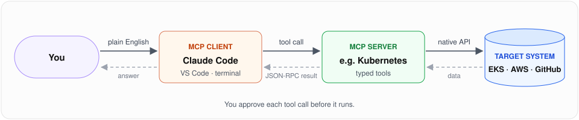

# 🔌 MCP for DevOps

Hands-on projects that connect AI agents to real infrastructure through the **Model Context Protocol (MCP)**.
Each project has an architecture diagram, step-by-step setup, a real demo run, and the guardrails needed to use it safely.

  
  
  

## What is MCP, in one picture

  

An **MCP server** turns an API (Kubernetes, AWS, a database…) into a set of typed *tools*. An **MCP client** such as
Claude Code discovers those tools and calls them for you, after you approve each call.

## Projects

| # | Project | MCP server | Target | Highlights | Status |
|:---:|---|---|---|---|:---:|
| 01 | [Kubernetes MCP + Claude Code on EKS](01-kubernetes-mcp-eks/) | `kubernetes-mcp-server` | Amazon EKS | Deploy, diagnose a `Pending` pod (*Too many pods*), scale, expose via NodePort | ✅ |

## How each project is structured

| Section | What it covers |
|---|---|
| **Architecture** | Diagram + numbered request flow |
| **Prerequisites** | Tools and install commands |
| **Steps** | Copy-paste setup, from an empty account to a working agent |
| **Demo** | The prompts used, the MCP tools called, and the outcome |
| **Safety** | Approval, allowlists, read-only modes and least privilege |
| **Troubleshooting** | Real errors hit along the way, and their fixes |

---

Part of [N-Subramanya](https://github.com/N-Subramanya)'s profile. ⭐ Star the repo to follow along as more MCP projects land.
